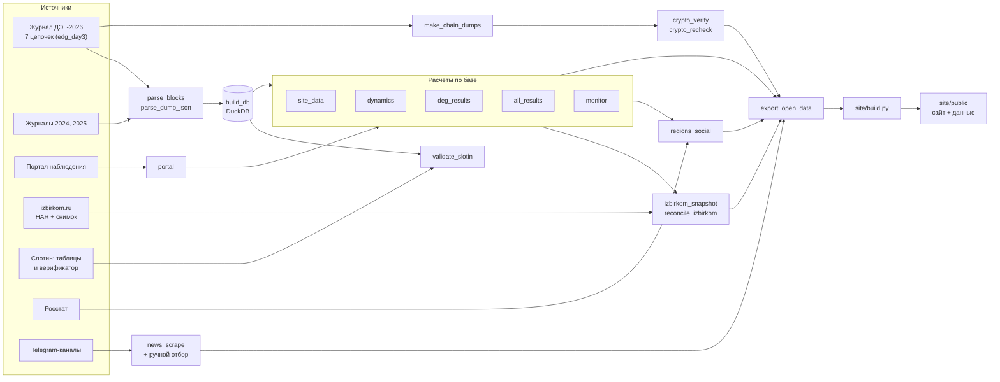
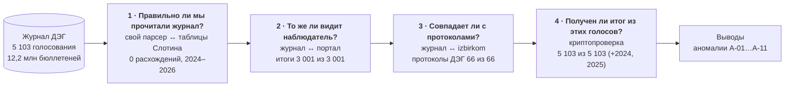
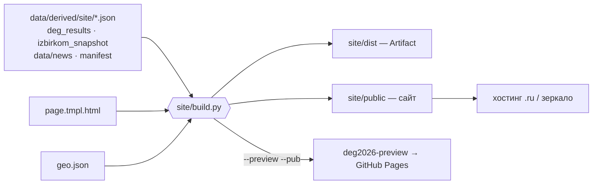

# Техническое руководство deg2026

Что сделано, как это устроено и на чём держатся выводы. Подробности по каждому модулю — в `docs/tech/`,
обоснования решений — в `docs/decisions.md` (№1–35), разбор находок — в `docs/anomalies/`.

**Коротко.** deg2026 — независимый пересчёт федерального ДЭГ 18–20 сентября 2026 года (32 региона) по открытым
данным. Журнал блокчейна разобран собственным парсером, итоги проверены четырьмя независимыми способами,
результаты опубликованы на статическом сайте с открытыми данными. Персональных данных наружу не выходит.

## 1. Общая схема



Картинкой: [diagrams/01-pipeline.png](diagrams/01-pipeline.png) (SVG рядом). Исходники всех схем — `docs/diagrams/*.mmd`
(Mermaid; пересборка — раздел 10).

## 2. Источники данных

| Источник | Что даёт | Как получен | Где лежит | В git |
|---|---|---|---|---|
| Журнал ДЭГ-2026, 7 цепочек | все транзакции: списки, выдача бюллетеней, голоса, закрытие, расшифровка, итоги | копии для наблюдателей (выгрузка `dump-chunked.py` в помещении ОП); полная — day3 | `ДЭГ IT/edg_day3/` (tar + каталог), day1/day2 — ранние частичные | нет |
| Журналы 2024, 2025 | то же за прошлые годы | публичные дампы (Яндекс.Диск, ссылки из README Слотина), `fetch_yadisk` | `data/external/raw_dumps/` | нет |
| Портал stat.vybory.gov.ru | названия выборов, округов, кандидатов; тип бюллетеня; итоги видимых голосований; счётчики | API, `portal` (нужен российский IP) | `data/external/portal/raw/` — каждый ответ как есть | нет |
| izbirkom.ru | официальные протоколы ОИК/ТИК/УИК | HAR из обычного браузера (защиту не обходим) + открытый снимок github.com/Arhydemon/elections_20_09_26 (проверен нами) | `data/external/izbirkom*/` | нет |
| С. Слотин (github.com/sslotin/elections) | таблицы feddeg для сверки; открытый верификатор | снимок репозитория `elections-main.zip` | `ДЭГ IT/`, `data/external/slotin/` | нет |
| Росстат | «Регионы России — 2025», 7 показателей по регионам | rosstat.gov.ru (сертификаты Минцифры только в запросе) | `data/external/rosstat/` + SOURCE.txt с sha256 | нет |
| Telegram | хронология 11–24.09 | веб-превью `t.me/s/…`, 1 запрос/с, без входа | `data/external/news/`; отбор — `data/news/timeline.json` | отбор — да |

Исходники в `ДЭГ IT/` не изменяются никогда; всё производное — в `data/derived/` (воспроизводимо, в git не входит).

## 3. Конвейер по шагам

| № | Модуль | Вход | Выход | Контроль |
|---|---|---|---|---|
| 1 | `sources` | day3 (tar + каталог) | план чанков по цепочкам | непрерывность высот, 0 разрывов |
| 2 | `parse_blocks` (2026), `parse_dump_json` (2024/25) | чанки JSONL.gz | parquet по таблицам, `data/derived/blocks*` | маркеры `_done`, возобновление |
| 3 | `build_db` | parquet | `deg2026.duckdb` (+2024, 2025) | дедупликация по tx_id, время МСК |
| 4 | `validate_slotin` | база + таблицы Слотина | `validation_slotin*.json` | 0 расхождений (A–E) |
| 5 | `portal` | API портала | `data/derived/portal/*.parquet` | 6 469 запросов, 0 ошибок |
| 6 | `site_data`, `dynamics` | база, портал | агрегаты регионов/УИК, 2024–2026 | явка 90,876 % = офиц. 90,87 % |
| 7 | `deg_results` | база, портал | Госдума: 1 044 пары ТИК, 81 округ | пары без остатка; округа — точно/реконструкция |
| 8 | `all_results` | база, портал, deg_results | 637 выборов, строки бюллетеня, «гонки» | итоги = портал 3 001/3 001 |
| 9 | `reconcile_izbirkom`, `izbirkom_snapshot` | HAR, снимок, deg_results | бумага = ОИК − ДЭГ (36 округов) | HAR↔снимок 384 строки; ДЭГ↔журнал 66/66 |
| 10 | `make_chain_dumps` → `crypto_verify` → `crypto_recheck` | day3 | статусы каждого голосования | 5 103/5 103 (2024: 2 103, 2025: 3 046) |
| 11 | `regions_social` | site_data, Росстат | корреляции (Спирмен, бутстреп, Холм) | зерно фиксировано |
| 12 | `monitor` | база | сигналы R1–R6 | ловит A-01, A-02, A-03 |
| 13 | `news_scrape` | Telegram | кандидаты → ручной отбор | у события — сверка с журналом |
| 14 | `export_open_data` | всё выше | `site/public/data/*`, Excel, ZIP, manifest | только агрегаты |
| 15 | `site/build.py` | JSON + шаблон + геометрия | `site/public/`, `site/dist/` | `node --check` скриптов, скриншоты |

Все модули запускаются одинаково: `run.cmd <модуль> [аргументы]` → `python -m deg.<модуль>`, лог в `logs/`.

## 4. Как проверены данные



Слои независимы: ошибка в одном не маскируется другим. Слой 1 проверяет наш код (два независимых парсера на
~12 млн событий совпали до секунды). Слой 4 проверяет саму систему: открытый верификатор без изменений кода
заново складывает зашифрованные голоса и проверяет доказательства расшифровки. Что понадобилось, чтобы слой 4
прошёл на 100 % (порядок записей в блоке, отложенная расшифровка, отброшенные голоса), — docs/tech/08-crypto.md.

## 5. Модель данных (DuckDB)

| Таблица | Строка = | Ключевые поля |
|---|---|---|
| `blocks` | блок цепочки | chain, height, block_ts, block_msk |
| `contracts` | создание голосования | contract_id, poll_id, dimension `[[1, мест, строк]]`, bulletin_hash |
| `contract_events` | служебное событие | op: addMainKey, startVoting, finishVoting, decryption, commissionDecryption, results; payload |
| `list_events` | изменение списка ДЭГ | op: addVotersList / removeFromVotersList, uik, n |
| `list_hashes` | хеши записей списка | только для расчётов, наружу не выходит |
| `ballots` | выдача бюллетеня | contract_id, region_code, uik, user_id (обезличенный), ts_msk |
| `votes` | транзакция голоса | contract_id, vote_hash (NULL — контракт голос не записал), blindsig_sha1, ts_msk |

Время — МСК без зоны (UTC + 3), источник — время внутренней транзакции (tx_ts).

## 6. Ключевые методические решения

- **Люди, а не бюллетени.** Человек получает сразу несколько бюллетеней; явка = получившие бюллетень ÷ список
  за вычетом исключённых. Для сравнения лет на УИК берётся «представительный» контракт (максимум бюллетеней) —
  для 2026 он даёт ровно 3 650 803 = числу разных избирателей.
- **Госдума по ТИК.** 2 088 контрактов ГД разбиты на 1 044 пары с одинаковым набором УИК (партсписок + округ);
  1 926 из них на портале не видны (A-06). Округ определяется по порталу, иначе по размерности и сходству итогов.
- **Бумага = протокол ОИК − протокол ДЭГ** (ДЭГ в протоколы ТИК не входит). Только там, где есть оба протокола.
- **Все выборы.** Итог — из журнала, названия — с портала, тип бюллетеня — поле `type` (UNION/SINGLE).
- **Криптопроверка.** Код верификатора не меняется; меняется только вход (порядок `results` в блоке) и явные
  режимы обёртки. Непройденное не списывается, а перепроверяется.
- **Социология.** Только ранговые связи на уровне регионов, с поправкой на множественные сравнения.

## 7. Сайт



Полная схема: [diagrams/03-site.png](diagrams/03-site.png).

- Одна самодостаточная страница: шаблон `site/page.tmpl.html` (разметка, стили, JS без библиотек), данные
  вставляются при сборке как JSON (`__GEO__`, `__DATA__`, `__RES__`, `__NEWS__`, `__FILES__`, `__ELECT__`,
  `__SOCIAL__`, `__MONITOR__`). Внешних запросов нет; CSP запрещает сеть.
- Разделы — маршруты по `#`: карта, что это, регионы, аномалии, хронология, результаты, все выборы, проверка, данные.
- Карта: 89 субъектов по Конституции РФ (Natural Earth, проекция Альберса), цвет — квинтили по 32 регионам.
- Тёмная тема по умолчанию, светлая по кнопке; на телефоне — нижняя панель вместо боковой, таблицы — карточками.
- Сборки: по умолчанию `noindex` + `Disallow: /`; открытие — только `--launch --base-url`. `--preview --pub` —
  отдельная папка с пометкой «предварительная версия» для временной ссылки.
- Cookies и счётчиков нет; в браузере хранится только выбор темы и «окно помощи уже показано».

## 8. Безопасность и приватность

- Наружу — только суммы по регионам, участкам (публичный номер УИК) и голосованиям (публичный id контракта).
  Обезличенные `user_id` и хеши списков используются только внутри расчётов.
- `ChatExport*`, HAR (содержат cookies), сырые дампы — только локально, в `.gitignore`.
- Защиту izbirkom не обходим: протоколы записывает человек в обычном браузере.
- Материалы «нежелательных организаций» не используются; иноагенты — с маркировкой по форме Правительства РФ
  и сверкой с реестром перед публикацией (`data/news/sources.json`).
- Git-операции записи выполняются только на Windows самим Алексом; история проверена на секреты.

## 9. Воспроизводимость

- Детерминированность: сортировки с тай-брейком по contract_id; фиксированное зерно в статистике (20260920).
- Контрольные суммы: `chain_dumps/_manifest.json` (sha256 склеенных цепочек), `rosstat/SOURCE.txt`, SHA256SUMS снимка izbirkom.
- Каждый модуль пишет `report.json`/`summary.json` со сверками; логи верификатора — `logs/*.log.gz`.
- Удалённые промежуточные файлы пересобираются командами (решение №31).

## 10. Обслуживание документации и схем

Схемы — Mermaid в `docs/diagrams/*.mmd`; GitHub рисует блоки ```` ```mermaid ```` в этом файле сам. Картинки:
`npm i -g @mermaid-js/mermaid-cli`, затем `mmdc -i 01-pipeline.mmd -o 01-pipeline.svg -b white` (и `.png -s 2`).

## 11. Известные ограничения

- Только электронная часть; бумага — для 36 из 81 округа Госдумы, по региональным и муниципальным выборам не собрана.
- 27 округов Госдумы в ДЭГ собраны реконструкцией по сходству итогов и ещё не сверены с протоколом (на сайте — «Реконструкция»); 17 собраны точно по журналу, 37 сверены с протоколом.
- В Калининградской области имена кандидатов в ДЭГ-итогах неизвестны (A-11).
- Данные не позволяют узнать, кто как голосовал (так задумано), и не показывают причин исключения из списка
  или ранней явки: необычные закономерности — повод для вопросов, а не вывод о принуждении.
- Московский ДЭГ не сравнивается количественно: открытых данных нет (docs/tech/13-moscow.md).

## 12. Карта документации

| Файл | О чём |
|---|---|
| `docs/OPERATOR_GUIDE.md` | как повторить всё по шагам и что делать на следующих выборах |
| `docs/SITE_GUIDE.md` | как пользоваться сайтом (для посетителя) |
| `docs/OP_BRIEF.md` | итоги для официального адресата |
| `docs/ROADMAP.md` | план развития |
| `docs/tech/00…14` | модули: окружение, парсер, портал, izbirkom, динамика, сайт, итоги ГД, снимок, крипто, новости, публичный сайт, все выборы, Росстат, Москва, монитор |
| `docs/anomalies/` | карточки A-01…A-11 |
| `docs/decisions.md` | журнал решений №1–35 |
