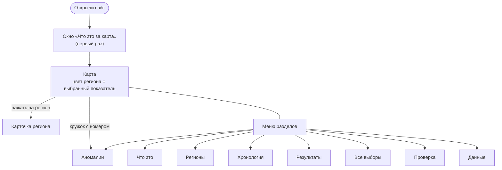

# Как пользоваться сайтом «ДЭГ-2026 в открытых данных»

## За одну минуту

В сентябре 2026 года в 32 регионах можно было проголосовать через интернет — это **ДЭГ**, дистанционное
электронное голосование. Каждое действие системы (кто-то записался, получил бюллетень, отправил голос,
голосование закрылось, подведён итог) записывалось в открытый журнал — блокчейн. Копии журнала выдали наблюдателям.

Мы **скачали журнал целиком и пересчитали всё сами**: сколько людей записалось, сколько получили бюллетень,
когда голосовали, какие получились итоги. Потом сверили с официальными данными четырьмя способами. На сайте —
результаты, найденные странности и все данные для самостоятельной проверки.

**Чего на сайте нет и быть не может:** кто за кого голосовал. Голоса в журнале зашифрованы, а расшифровывается
только их сумма — так устроена система.

## Как устроен сайт

Картинкой: [diagrams/04-site-map.png](diagrams/04-site-map.png).

**Вверху** — меню разделов (на телефоне листается пальцем вбок), кнопка **?** (снова показать подсказку) и
кнопка **◐** (светлая или тёмная тема; сайт запомнит выбор).

## Разделы

### Карта
- **Слева** (на телефоне — кнопки над картой) выберите показатель. Регион раскрашивается по нему: чем темнее
  синий, тем выше значение. Шкала — пять равных групп по 32 регионам. Серые регионы — там ДЭГ не было.
- **Нажмите на регион** — откроется карточка: все показатели региона, «Когда голосовали» (выдача по часам
  в сравнении со всеми регионами), «Как различаются участки», участки с самой высокой явкой и динамика 2024–2026. На телефоне карточка выезжает снизу; потяните её вверх, чтобы развернуть.
- **Кружки с цифрами** — найденные странности. Нажмите, чтобы прочитать разбор.
- Карту можно двигать мышью или пальцем, приближать кнопками **+ / −** или колесом, переключать «Вся страна»
  и «Европа и Урал». Границы субъектов — по Конституции РФ.

### Что это
ДЭГ простыми словами: как проходит голосование через интернет, что записывается в журнал, что значит каждый
показатель и какие у него обычные значения.

### Регионы
Все 32 региона одной таблицей. Нажмите на заголовок столбца, чтобы отсортировать, на строку — чтобы открыть регион
на карте. Ниже — **«С чем связаны различия между регионами»**: выберите показатель ДЭГ и показатель Росстата,
и точечный график покажет, есть ли между ними связь. Число ρ справа — от −1 до 1: чем дальше от нуля, тем сильнее
связь. Надпись под графиком скажет, устойчива ли она или может быть случайной.

### Аномалии
Карточки A-01…A-11. У каждой — метки вердикта:

| Метка | Что значит |
|---|---|
| **Подтверждено** | явление есть в данных, проверено |
| **Объяснено технически** | явление есть, но у него обычное техническое объяснение |
| **Ошибка наблюдения** | тревога оказалась ложной (например, сбой выгрузки у наблюдателя) |
| **Примечание** | не нарушение и не сбой: замечание о полноте или удобстве данных для наблюдателя (A-06, A-11) |
| **Причины не проверить** | что произошло — видно, а почему — по открытым данным установить нельзя |

«Подробнее» раскрывает данные и возможные объяснения; «Показать регион на карте» открывает регион.

### Хронология
События 11–24 сентября: заявления ЦИК, Минцифры, Общественной палаты, публикации СМИ и наблюдателей.
У каждого события — **сверка с журналом** («Подтверждается данными», «Частично / не совсем», «Данными не проверяется», «Вне наших данных», «Наше наблюдение») и ссылки на источники.
Крупные СМИ помечены отдельно. Материалы иностранных агентов сопровождаются маркировкой, как требует закон.

### Результаты
Итоги ДЭГ по выборам в Госдуму для всех 32 регионов и 81 округа.
- **Партии по регионам:** выберите партию; синяя точка — доля в ДЭГ, оранжевая — на участках (где есть официальный протокол).
- **Одномандатные округа:** выберите регион; у каждого округа метка точности: «Есть протокол» (сверено с
  официальным протоколом), «Собрано точно» (по журналу однозначно), «Реконструкция» (часть данных отнесена к
  округу по сходству, ждёт сверки).
- **Явка:** через интернет голосуют те, кто заранее записался, поэтому явка ДЭГ (~90 %) намного выше, чем на
  участках. Это главная причина, почему результаты ДЭГ и бумаги различаются.

### Все выборы
Губернатор Белгородской области, 14 заксобраний, 6 довыборов и 595 муниципальных выборов — только электронная
часть. Сверху — сравнение «заксобрание против Госдумы» для одних и тех же избирателей. Внизу — таблица всех
округов с фильтрами по региону и типу и поиском по названию или фамилии. «Лидер в ДЭГ» — не победитель выборов:
на участках результат может быть другим.

### Проверка
Как проверялись данные (четыре слоя), подробности криптографической проверки, автоматический монитор
(что он увидел бы во время голосования) и методика с ограничениями.

### Данные
Всё, что на сайте, можно скачать:
- **«Таблицы для Excel»** — одна книга, вкладка на таблицу, заголовки по-русски. Проще всего начать с неё.
- **«Весь набор (ZIP)»** — все файлы, включая список всех голосований и итоги криптопроверки.
- Отдельные файлы CSV — для программ (R, Python, Excel через «Данные → Из текста/CSV»).

Лицензия CC BY 4.0: данные можно использовать в работах, статьях и отчётах со ссылкой на источник.

## Показатели карты

| Показатель | Что это | Обычно |
|---|---|---|
| **Явка ДЭГ** | сколько записавшихся на электронное голосование получили бюллетень | 88–94 % |
| **Первый час** | доля бюллетеней, выданных 18 сентября с 8 до 9 утра по местному времени | ~22 % |
| **Без голоса** | бюллетень открыт, а голос так и не принят (передумал, закрыл страницу, сбой) | ~0,9 % |
| **Участки со 100 %** | доля участков (от 50 человек в списке), где бюллетень получили все записавшиеся | ~0,4 % |
| **Исключены из списка** | записались, а потом убраны из списка ДЭГ — чаще всего пошли на участок | ~1 % |
| **Видно на портале** | какую часть бюллетеней региона можно увидеть на официальном портале наблюдения | ~47 % |

Высокое значение само по себе не нарушение. Необычные закономерности — повод задать вопрос, а не вывод.

## Частые вопросы

**Можно ли узнать, как проголосовал конкретный человек?** Нет. Голоса зашифрованы; расшифровывается только сумма.
Персональных данных на сайте нет.

**Почему явка 90 %, если на выборы обычно приходит около половины?** Считается явка среди тех, кто сам записался
на электронное голосование. Записываются те, кто собирается голосовать.

**Совпадают ли ваши цифры с официальными?** Да, там, где их можно сравнить: явка 90,88 % против официальных 90,87 %,
итоги всех 3 177 голосований, которые показывает портал наблюдения, — с порталом до единицы, электронные протоколы — с журналом 66 из 66.

**Что значит «подтверждено криптографически»?** Независимая программа заново сложила зашифрованные голоса каждого
из 5 103 голосований и проверила, что опубликованный итог — расшифровка именно этой суммы. Итог сошёлся везде.

**Почему у части калининградских выборов вместо фамилий номера?** Портал наблюдения не публикует бюллетени и итоги
этих голосований (карточка A-11). Итоги есть в журнале, но какой номер — какой кандидат, видно только из протокола.

**Сайт не открывается / карта пустая.** Нужен современный браузер с включённым JavaScript. Если на телефоне страница
открыта из файла, откройте её по ссылке.

## Как ссылаться

ДЭГ-2026 в открытых данных: результаты федерального ДЭГ 18–20 сентября 2026 г. по данным блокчейна / Xandret. — 2026.
— Данные: CC BY 4.0.
